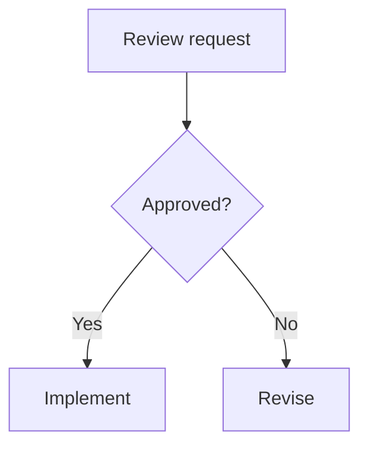

# AI Instructions: Create Marp Slides

Generate Marp slides in `slides/marp/` with required AI provenance metadata.

## File Location & Naming

- Path: `slides/marp/`
- Filename: lowercase kebab-case (e.g., `intro-to-aiasd.md`)

## Required YAML Front Matter

```yaml
---
ai_generated: true
model: "<provider>/<model-name>@<version>"
operator: "<github-username>"
chat_id: "<chat-id>"
prompt: |
  <exact prompt text>
started: "<ISO8601-timestamp>"
ended: "<ISO8601-timestamp>"
task_durations:
  - task: "draft"
    duration: "<hh:mm:ss>"
total_duration: "<hh:mm:ss>"
duration: "<estimated-deck-duration-hh:mm:ss>"
ai_log: "ai-logs/<yyyy>/<mm>/<dd>/<chat-id>/conversation.md"
source: "<source-identifier>"
---
```

## Marp Slide Template

```markdown
---
ai_generated: true
model: "anthropic/claude-3.5-sonnet@2024-10-22"
operator: "username"
chat_id: "unique-id"
prompt: |
  Create 5-slide intro to topic
started: "2025-10-23T14:30:00Z"
ended: "2025-10-23T14:35:00Z"
task_durations:
  - task: "draft"
    duration: "00:05:00"
total_duration: "00:05:00"
duration: "00:02:00"
ai_log: "ai-logs/2025/10/23/unique-id/conversation.md"
source: "username"
---

# Slide Title

Content here

::: notes
- Time: ~00:01:00
- Key points:
  - Emphasize the main idea.
  - Connect it to the audience's current work.
- Slide narrative: Explain how the key points connect and why they matter, without simply repeating the slide text.
:::

---

## Slide 2

- Bullet points
- More content

::: notes
- Time: ~00:01:00
- Key points:
  - Explain the main evidence.
  - Transition to the next concept.
- Slide narrative: Give a concise spoken explanation of the evidence and connect it to the next concept.
:::

---
```

## Speaker Notes Requirements

**MANDATORY**: Every slide MUST include comprehensive speaker notes using pandoc syntax:

```markdown
::: notes
Speaker notes content here
:::
```

**Speaker Notes Content Guidelines**:

- **Delivery Instructions**: How to present the content effectively
- **Timing Guidance**: Suggested time allocation for each slide
- **Key Points**: Essential messages to emphasize
- **Examples**: Real-world illustrations or case studies
- **Transitions**: How to connect to the next slide
- **Audience Interaction**: Questions, polls, or discussion points
- **Background Context**: Additional details not shown on slide

**Key Points and Narrative**:

- Put key points and delivery cues before a distinct `Slide narrative:` paragraph.
- Use a short, presenter-ready narrative that connects the key points and adds relevant context; do not merely repeat slide text.
- Keep both parts accurate, concise, and easy to scan. Use fewer key points on title or transition slides.

**Placement**: Speaker notes MUST be placed immediately after each slide's content, before the next slide separator (`---`).

## Presentation Duration Estimates

- Each slide MUST include an estimated delivery time in its `::: notes` block using `- Time: ~HH:MM:SS`.
- Each deck MUST include a top-level YAML `duration: "HH:MM:SS"` equal to the sum of its slide estimates. This is presentation time, not AI task `total_duration`.
- Use the speaker notes as the primary input. Estimate the spoken narrative and any examples, demos, questions, learner work, discussion, and transitions they call for. Check that the slide's time cue is plausible for its actual delivery plan; exclude breaks and logistics.
- As a starting point, allow roughly 150-180 spoken words per minute for prepared narration, then account for visual inspection, emphasis, pauses, tool delays, learner participation, and debriefs.
- Use concrete allocations and round to a useful 15- or 30-second increment. Do not assign the full activity duration to each slide when it spans several slides.
- Treat estimates as a delivery plan, not a target to pad toward. Rehearse longer demos or interactive sections when practical and revise estimates from observed time.

## Tables

Use standard Markdown pipe tables for compact comparisons. The PowerPoint generator renders supported tables as native tables at 80% of slide width, so keep the number of columns and cell text small enough to remain readable.

```markdown
| Aspect  | Instructions | Prompts |
| ------- | ------------ | ------- |
| Scope   | Repository   | Task    |
| Purpose | Define rules | Execute |
```

## Diagrams

Use fenced Mermaid blocks for diagrams instead of ASCII art or manually aligned text. The PowerPoint generator renders Mermaid when `mmdc` or `npx` is available; without Mermaid CLI, the diagram remains code in the output. Verify the generated slide deck when a diagram is important to the presentation.

For clarity, use explicit node and branch labels, restrained contrast-safe colors, and do not rely on color alone to convey meaning.

````markdown

````

## Exercise Slides

For exercises that need separate setup/objectives and activity/success-criteria columns, use the `Two Content` layout and `::: column` divider supported by the PowerPoint generator:

```markdown
## Exercise: <Title>

**Setup and Objectives**

- Prerequisite or objective

::: column

**Activities and Success Criteria**

1. Complete the activity.
2. Verify the result.

::: notes
- Time: ~00:05:00
- Key point: State what participants should achieve.
- Slide narrative: Explain how the activity applies the concept and how participants will confirm success.
:::
```

Use `<!-- layout: Two Content -->` only when needed; if specified, the name must match a layout in the selected PowerPoint template. Divide activity time across the slides that actually carry each part of the exercise.

## Generation Rules

**Required**:

- Embed YAML front matter (no sidecar `.meta.md`)
- Use actual model name in format `provider/model@version`
- Create `ai-logs/<yyyy>/<mm>/<dd>/<chat-id>/conversation.md`
- Capture exact prompt verbatim
- Use ISO8601 timestamps
- **Include comprehensive speaker notes for EVERY slide**
- Use pandoc `::: notes` syntax for speaker notes
- Ensure speaker notes provide delivery guidance and context
- Put key points before a distinct `Slide narrative:` paragraph in each slide's notes
- Include a `Time: ~HH:MM:SS` estimate in each slide's notes and set the deck `duration` to their sum

**Prohibited**:

- Generic model names like "github/copilot"
- Creating slides without active chat context
- Omitting any required metadata fields
- **Creating slides without speaker notes**
- Using incorrect speaker notes syntax

## Checklist

- [ ] File in `slides/marp/`
- [ ] All YAML fields present
- [ ] `ai_log` path exists with conversation.md
- [ ] `operator` is GitHub username
- [ ] Timestamps in ISO8601 format
- [ ] **Every slide has comprehensive speaker notes**
- [ ] **Speaker notes use correct pandoc `::: notes` syntax**
- [ ] **Speaker notes include delivery guidance, timing, and context**
- [ ] **Each slide has a plausible `Time` estimate based on its speaker notes**
- [ ] **Deck `duration` equals the sum of its slide estimates**
- [ ] Complete [Post-Creation Requirements (CANONICAL)](ai-assisted-output.instructions.md#post-creation-requirements-canonical)

## README Entry Template

```markdown
- **[Title]** (`slides/marp/[filename].deck.md`) — [Description]. Provenance: `ai-logs/[yyyy]/[mm]/[dd]/[chat-id]/`
```

## Reference

See `.github/instructions/ai-assisted-output.instructions.md` for complete provenance requirements.
