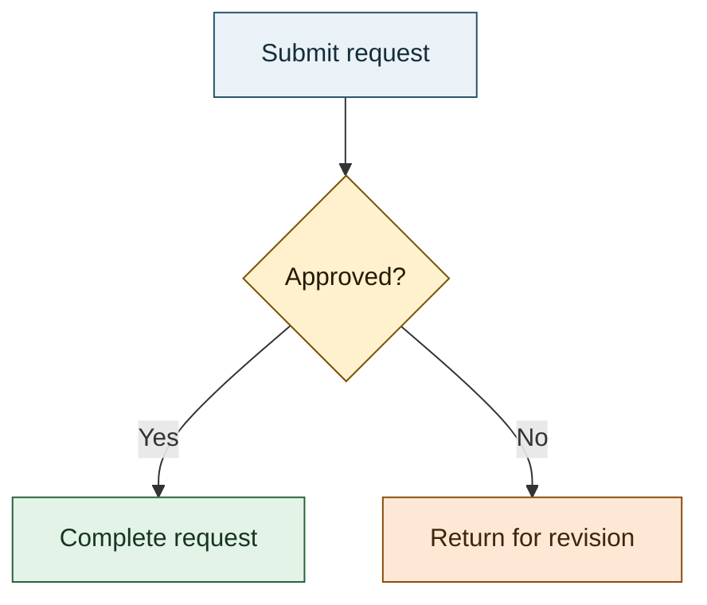

# Mermaid Diagram Authoring

## Overview

Use this guidance for Mermaid diagrams, not ordinary Markdown edits. The file
pattern targets standalone `.mmd` sources; load this instruction by task relevance
or attach it explicitly for fenced Mermaid in Markdown. Verify discovery in the
selected harness rather than assuming every harness uses description-based loading.

For Marp content, also follow the consuming repository's slide-authoring guidance and
[pipeline constraints](slide-pipeline.instructions.md). Do not replace their
renderer-specific requirements with generic Mermaid syntax.

## Table of Contents

- [Diagram structure](#diagram-structure)
- [Semantic colors](#semantic-colors)
- [Example](#example)
- [Validation checklist](#validation-checklist)
- [Summary](#summary)

## Diagram structure

- Choose the diagram type for the question: flowchart for branching processes,
  sequence diagram for interactions, state diagram for transitions, class diagram
  for types, or ER diagram for data relationships.
- Use a `mermaid` fence in Markdown; write raw Mermaid in standalone `.mmd` files.
- Give nodes explicit labels and decision edges named outcomes. Keep direction
  and notation consistent; explain abbreviations.
- Keep each diagram focused. Split crowded diagrams instead of shrinking labels
  below a readable size. Preserve verified system relationships; do not invent
  architecture or behavior to fill a visual gap.

## Semantic colors

Color is optional. When used, map it to meaning, not node order or decoration.
Use only roles that improve comprehension and reuse the mapping across related
diagrams. Keep ordinary elements neutral.

| Role | Example fill / stroke / text |
|---|---|
| Ordinary step | `#EAF2F8` / `#28536B` / `#152D3A` |
| Decision | `#FFF0CE` / `#785400` / `#241B00` |
| Success | `#E3F3E8` / `#28613A` / `#173522` |
| Warning/retry | `#FCE8D5` / `#8A4B08` / `#3D260C` |
| Failure/rollback | `#FBE5E3` / `#8C3B35` / `#4B1F1B` |
| External system | `#E3F2F1` / `#28635E` / `#163A37` |

- Prefer reusable `classDef`/`class` roles where the diagram type and renderer
  support them; do not transplant flowchart styling into incompatible diagram types.
- Set fill, stroke, and text together when overriding theme defaults. Target at
  least 4.5:1 text-to-fill contrast for normal text; verify the actual output.
- Do not rely on color alone. Pair status/category with labels, branch text,
  shapes, or another visible distinction. Preserve meaning in grayscale and for
  readers with color-vision deficiencies.
- Inspect light/dark themes and exported output when relevant. Do not equate
  syntax validity or a palette example with accessible rendering.

## Example

Revision is a retry outcome, not necessarily failure. Choose roles from domain
meaning; retain labels even when removing all styling.

## Validation checklist

- [ ] Diagram type, labels, and branches express verified relationships.
- [ ] Styling syntax is supported by the target renderer/version.
- [ ] Color meanings are consistent, optional, and reinforced by non-color cues.
- [ ] Text contrast and readability are checked at the intended display/export size.
- [ ] Render in the target environment; inspect labels, edges, clipping, and layout.
- [ ] Report unavailable rendering or accessibility checks explicitly.
- [ ] Follow slide/pipeline requirements for Marp; follow
      [provenance policy](ai-assisted-output.instructions.md) for durable artifacts.

## Summary

Use explicit relationships and labels first; add semantic color only when useful.
Validate the rendered result, not just the Mermaid source.

Reference: [Mermaid documentation](https://mermaid.js.org/intro/).

---

**Document Version**: 1.0.0  
**Last Updated**: 2026-10-18  
**Maintainer**: johnmillerATcodemag-com  
**Related Instructions**: [pipeline](slide-pipeline.instructions.md)
