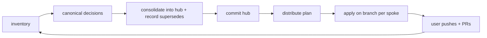

# Sync Strategy: Canonical Hub, Repo Spokes

## Model

- **Hub**: this repo holds the canonical copy of every shared config file.
- **Spokes**: every git repo under `root` (default `c:\git`). Spokes may hold repo-specific files; they are never deleted.
- **Changes flow one way**: spoke edits come back to the hub through _consolidate_, then go out through _distribute_. Do not edit shared files in spokes and forget to consolidate them.
- **Legacy prompts**: `.github/prompts/` remains visible to inventory as migration input, but prompt files are not imported or distributed. Compare each prompt with canonical skills and set its manifest entry to `distribute: "none"`.

## Lifecycle Loop



## Cadence

| Trigger                            | Action                                                                   |
| ---------------------------------- | ------------------------------------------------------------------------ |
| Changed a shared file in the hub   | Commit, then distribute plan + apply                                     |
| Edited a shared file in a spoke    | Inventory, consolidate into the hub, then distribute                     |
| Weekly / before a class or release | Inventory across all repos; fix `target-ahead`/`forked`                  |
| New repo created                   | Add to manifest if not `sync`; distribute with `distribute: "all"` files |

## Manifest: `.github/github-config-sync.json`

```jsonc
{
  "root": "c:\\git",
  "maxDepth": 3,
  "include": [".github/**", "AGENTS.md", "CLAUDE.md", ".vscode/mcp.json"],
  "exclude": [".github/.stfolder/**", ".github/github-config-sync.json"],
  "skipDirs": ["node_modules", "archive", "bin", "obj", ".venv", "__pycache__"],
  "defaultMode": "sync", // sync | report | ignore
  "repos": {
    "Lore": { "mode": "report" }, // plan only, never written
    "AIASD/Fleetly": {
      "exclude": [".vscode/mcp.json", ".github/workflows/**"],
    },
  },
  "files": {
    ".github/prompts/update-application-c4-diagrams.md": {
      "distribute": "none"
    },
    ".github/instructions/ai-assisted-output.instructions.md": {
      "distribute": "all",
    },
    ".github/agents/slide-master.agent.md": {
      "distribute": "repos",
      "repos": ["AIASD/*"],
    },
    ".github/agents/github-config-sync.agent.md": { "distribute": "none" },
    ".github/instructions/x.instructions.md": {
      "supersedes": ["<normHash>"],
      "consolidated": "<ISO8601>",
    },
  },
}
```

- `distribute`: `existing` (default; update only repos that already have the file), `all` (also add to every `sync` repo), `none` (hub only). A `repos` list (wildcards allowed) adds the file to matching repos.
- `supersedes`: normalized content hashes of versions replaced by the canonical one. Written by the consolidate script. Lets distribute overwrite spoke copies that are not in hub git history (for example after a hand merge).
- Repo keys are paths relative to `root` with `/`; wildcards such as `Teleflex/*` are allowed (exact keys win, then the first matching wildcard).

## Safety Guarantees

| Spoke state                     | Result                                     |
| ------------------------------- | ------------------------------------------ |
| Same content                    | `in-sync`, untouched                       |
| Older hub version or superseded | `update`                                   |
| Evolved from hub version        | `target-ahead`, skipped until consolidated |
| Unrelated edits                 | `forked`, skipped until consolidated       |
| Uncommitted copy or dirty repo  | Skipped                                    |
| Missing file                    | `add` only if the manifest says so         |
| Spoke-only file                 | Reported as `target-only`                  |

Writes happen on a new branch per spoke; commit is opt-in (`-Commit`); push and PR are always manual.

## Complete Planning Report

Planning is concise by default: differences and blockers, including `target-only`, with a brief `Reason`. Add `-Detailed` to include every selected, in-scope spoke config file, plus hub files missing from that spoke. Both the JSON `Plan` and console table include the repository, path, `Action` (sync status), and a brief `Reason`. The switch affects reporting only, not write eligibility.

Plan one repository using its key relative to the configured root (not its absolute filesystem path):

```powershell
.\.github\skills\github-config-distribute\scripts\Sync-GithubConfig.ps1 -Repo 'AIASD/Fleetly'
.\.github\skills\github-config-distribute\scripts\Sync-GithubConfig.ps1 -Repo 'AIASD/Fleetly' -Detailed
```

Repository keys use `/`, even on Windows; command paths use `\`. Wildcards such as `-Repo 'AIASD/*'` select groups. Each run replaces the default temporary report; use `-ReportFile` with a different output path to retain separate plans.

- With `-Detailed`, matching files are visible as `in-sync`; spoke-only files remain visible as `target-only` in either mode.
- With `-Detailed`, repository-excluded files are reported as `excluded`, and files with `distribute: "none"` as `distribution-disabled`. Neither status authorizes writes, including for legacy prompts.
- With `-Detailed`, missing hub files without addition permission are reported as `missing-not-distributed`. These and the other informational statuses above are omitted by default.
- `update` and `add` describe file-level eligibility, not a promise to write. Their reasons identify dirty working trees or non-sync repository modes that block application.
- Planning accepts dirty spokes. Actual writes require the entire spoke working tree to be clean.
- Global manifest scope/exclusions, discovery limits, ignored repositories, and explicit `-Repo` / `-Path` filters still bound the report. Git-ignored untracked files are not inventoried.
- Only `update` and `add` can be copied. Reporting additional statuses does not expand write permissions or delete files.

Run the [focused regression tests](../../../scripts/tests/sync-github-config.Tests.ps1) with `Invoke-Pester -Path .\.github\scripts\tests\sync-github-config.Tests.ps1 -Output Detailed` from the hub root.

## Automation Options

| Option                                                                                 | Fit                    | Notes                                                                                                                                                                         |
| -------------------------------------------------------------------------------------- | ---------------------- | ----------------------------------------------------------------------------------------------------------------------------------------------------------------------------- |
| Local script (current)                                                                 | Best start             | Works for local, unpublished, and multi-host repos; full control                                                                                                              |
| Scheduled local task running plan only                                                 | Drift alerts           | `Sync-GithubConfig.ps1` writes a JSON plan; review weekly                                                                                                                     |
| GitHub Actions in the hub                                                              | Org repos on GitHub    | Workflow checks out spokes with a GitHub App/PAT, runs the script with `-Apply -Commit`, pushes the branch, opens PRs. Needs `contents` + `pull-requests` write on the spokes |
| User-level customizations (VS Code profile prompts/agents folder, `~/.copilot/skills`) | Personal agents/skills | Removes the need to copy personal tools into every repo; not shared with teammates or GitHub.com                                                                              |
| Git submodule / symlinks for `.github`                                                 | Not recommended        | Copilot and Actions read real files at fixed paths; submodules need extra checkout steps, and symlinks break on Windows/GitHub                                                |
